<p align="center">
  
</p>

<p align="center">
  <a href="https://github.com/alok722/cleanyourphone/actions/workflows/ci.yml"></a>
  
  
  
  
  
</p>

<p align="center">
  <b>Paste one prompt into Claude Code, Codex or Gemini CLI. Tick what to remove. Done in about 5 minutes.</b><br>
  <a href="#quick-start">Quick start</a> · <a href="#how-it-works">How it works</a> · <a href="#tested-phones">Tested phones</a> · <a href="PROMPT.md">The prompt</a>
</p>

<p align="center">
  
</p>

Inspired by [cleanyourtv](https://github.com/Gathin23/cleanyourtv) by [@gathint](https://x.com/gathint), which does the
same for Android TVs.

## How it works

| Step | What happens |
|---|---|
| **Back up** | Every package, setting and default app is saved on your computer before anything changes. |
| **Debloat in batches** | Five apps at a time: disable (or, where the phone maker blocks that, uninstall for your user or suspend). The phone is checked after every batch, and a batch that breaks anything is undone automatically. |
| **Unused apps** | Lists the apps you installed but haven't opened in 30+ days; you pick which to uninstall. The rest are blocked from running in the background. |
| **Block ads** | System-wide ad-blocking DNS, plus the phone maker's own ad switches. |
| **Speed up** | Faster animations, the highest refresh rate, cleared caches, recompiled apps. |
| **Prove it** | Free RAM, app start times and janky frames, before and after. |
| **Restore** | One command puts everything back, from a journal written before each change. |

Core Android, calls, SMS, mobile data/VoLTE, Play Store, your keyboard and your home screen are
protected in code ([`data/never.txt`](data/never.txt)), whatever a list or an assistant asks for.

## Quick start

1. **On the phone:** Settings → About phone → tap **Build number** 7 times → Developer options →
   **USB debugging** on. Set Settings → Display → **Screen timeout to 30 minutes** (or the longest option) and keep
   the phone unlocked while it runs. Connect it to your computer with a USB data cable.
2. **On your computer:** clone this repo, open the folder in a coding assistant (Claude Code, Gemini CLI,
   Codex: free tiers are fine) and paste the contents of [`PROMPT.md`](PROMPT.md).
3. Tap **Allow** on the phone, tick what to remove in the assistant's question box, and wait about 5 minutes.

Without an assistant it's the same two commands:

```bash
git clone https://github.com/alok722/cleanyourphone && cd cleanyourphone
./cmp go                         # read-only: checks, backup, measures, lists the bloat in numbered groups
./cmp go --yes --remove "1 3" --uninstall "a"   # removes what you picked in checked batches, speeds up, reboots, reports
./cmp restore                    # undo everything, any time
```

On Windows use `.\cmp.ps1` instead of `./cmp`. Every step also exists on its own (`./cmp --help`).

## Tested phones

| Phone | Android | Status |
|---|---|---|
| [realme 7 (RMX2151)](devices/realme-7-rmx2151/debloat.txt) | 12, realme UI 3.0 | ✅ tested |
| [Xiaomi / Redmi / POCO](devices/xiaomi-starter/debloat.txt) | MIUI 12-14, HyperOS | 🧪 starter, untested |
| [Samsung Galaxy](devices/samsung-starter/debloat.txt) | One UI 2-6 | 🧪 starter, untested |
| [OPPO / OnePlus](devices/oppo-oneplus-starter/debloat.txt) | ColorOS 11-14, OxygenOS 12-14 | 🧪 starter, untested |
| [vivo / iQOO](devices/vivo-starter/debloat.txt) | Funtouch OS, OriginOS | 🧪 starter, untested |
| [Motorola](devices/motorola-starter/debloat.txt) | My UX | 🧪 starter, untested |
| [Any Android phone](devices/generic-android-starter/debloat.txt) | 7+ | 🧪 starter, untested |

Starter lists are never applied blindly: `cmp discover` only proposes what is actually on your
phone, preinstalled, and you review it first. Tested one on your phone? A PR with
`devices/<brand>-<model>/` turns it into a tested list.

## Legal

cleanyourphone is an independent open-source project, not affiliated with any phone maker. It only
uses what Android offers a phone's owner (Developer options, adb, `pm`), never roots or flashes, and
keeps a restore for every change. You run it on a phone you own, at your own risk.

## Licence

MIT, see [LICENSE](LICENSE).
